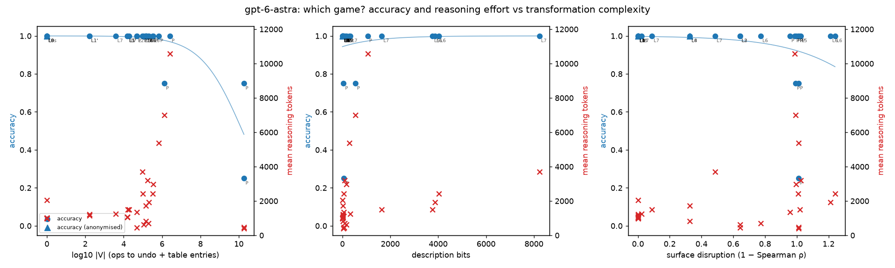
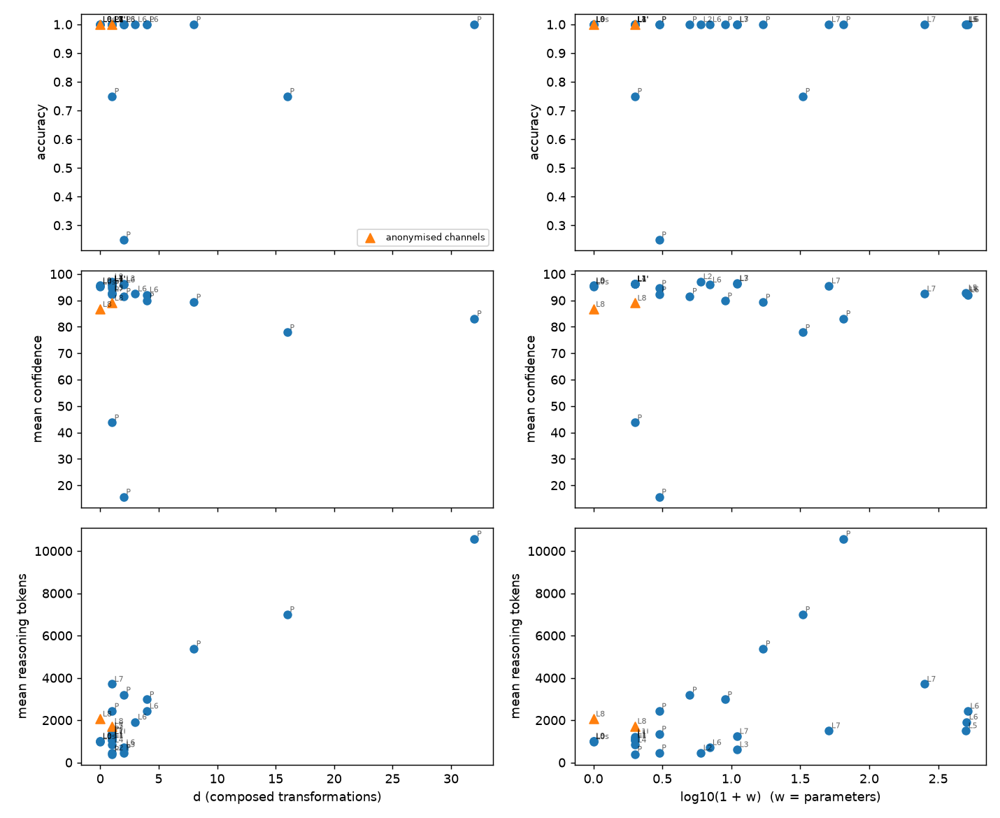

# Complexity sweep: where does Astra stop recognising the game?

Every condition computes exactly the same function as the original network (checked numerically, `python run.py verify`), states its transformation in the description and formula, and (sweep levels) prints weights at >= 3 significant digits and >= 3 decimals. Complexity measures follow Dziri et al. (2023): graph size |V|, depth, width; see `complexity.py` for the operation model.

## Per-condition results

| Condition | Level | d | w | ops/weight | depth | table | log10 V | desc bits | surface disr. | anon | runs | accuracy | mean conf | mean reasoning tok (min–max) | mean input tok |
|---|---|---|---|---|---|---|---|---|---|---|---|---|---|---|---|
| original | L0 | 0 | 0 | 0.0 | 0 | 0 | 0.00 | 0 | 0.000 |  | 12 | 100% | 95.5 | 980 (670–1,552) | 70,242 |
| x10_input | L1 | 1 | 1 | 1.0 | 1 | 1 | 4.20 | 16 | 0.000 |  | 8 | 100% | 96.4 | 1,046 (516–1,976) | 86,294 |
| div10_input | L1' | 1 | 1 | 1.0 | 1 | 1 | 4.20 | 16 | 0.000 |  | 8 | 100% | 96.2 | 1,078 (470–1,436) | 70,296 |
| x10_output | L1' | 1 | 1 | 1.0 | 1 | 1 | 2.22 | 16 | 0.000 |  | 8 | 100% | 96.2 | 1,146 (338–1,552) | 70,470 |
| div10_output | L1' | 1 | 1 | 1.0 | 1 | 1 | 2.22 | 16 | 0.000 |  | 8 | 100% | 96.2 | 1,220 (895–2,070) | 70,308 |
| L0s_sig3 | L0s | 0 | 0 | 0.0 | 0 | 0 | 0.00 | 0 | 0.000 |  | 8 | 100% | 95.1 | 997 (516–1,552) | 80,518 |
| L2_chscale | L2 | 1 | 5 | 3.0 | 3 | 5 | 4.68 | 80 | 0.643 |  | 8 | 100% | 97.1 | 457 (216–763) | 81,309 |
| L3_chaffine | L3 | 2 | 10 | 7.0 | 3 | 10 | 5.05 | 160 | 0.643 |  | 8 | 100% | 96.4 | 614 (311–1,552) | 86,708 |
| L4_flip | L4 | 1 | 1 | 9.0 | 7 | 0 | 5.16 | 16 | 0.327 |  | 8 | 100% | 96.4 | 832 (510–1,034) | 80,544 |
| L5_perm | L5 | 1 | 500 | 1.0 | 1 | 500 | 4.22 | 3767 | 1.021 |  | 8 | 100% | 92.9 | 1,507 (1,034–2,367) | 82,102 |
| L6a_flip_scale | L6 | 2 | 6 | 12.0 | 10 | 5 | 5.28 | 96 | 0.774 |  | 8 | 100% | 95.9 | 709 (354–1,034) | 81,384 |
| L6b_perm_flip_scale | L6 | 3 | 506 | 13.0 | 11 | 505 | 5.32 | 3863 | 1.213 |  | 8 | 100% | 92.5 | 1,917 (1,552–3,106) | 82,776 |
| L6c_perm_flip_scale_affine | L6 | 4 | 516 | 20.0 | 14 | 515 | 5.51 | 4023 | 1.241 |  | 8 | 100% | 92.1 | 2,431 (1,034–5,696) | 91,690 |
| L7_givens10 | L7 | 1 | 10 | 6.0 | 3 | 30 | 3.59 | 329 | 0.024 |  | 8 | 100% | 96.5 | 1,238 (516–2,070) | 81,404 |
| L7_givens50 | L7 | 1 | 50 | 6.0 | 3 | 150 | 4.29 | 1646 | 0.089 |  | 8 | 100% | 95.5 | 1,507 (1,034–2,549) | 83,636 |
| L7_givens250 | L7 | 1 | 250 | 6.0 | 3 | 750 | 4.99 | 8232 | 0.486 |  | 8 | 100% | 92.5 | 3,706 (1,815–5,434) | 95,208 |
| L8_anon | L8 | 0 | 0 | 0.0 | 0 | 0 | 0.00 | 7 | 0.000 | yes | 8 | 100% | 86.6 | 2,059 (1,355–3,589) | 80,426 |
| L8_anon_flip | L8 | 1 | 1 | 9.0 | 7 | 0 | 5.16 | 23 | 0.327 | yes | 8 | 100% | 89.0 | 1,714 (1,132–2,070) | 80,452 |
| L9_hidden_perm_sign | L9 | 0 | 0 | 0.0 | 0 | 0 | 0.00 | 0 | 0.000 |  | 8 | 100% | 95.6 | 1,025 (497–1,524) | 80,505 |
| P_aff | P | 1 | 2 | 3.0 | 3 | 2 | 4.68 | 64 | 0.956 |  | 8 | 100% | 94.6 | 1,348 (799–2,070) | 80,711 |
| P_xs_1 | P | 1 | 2 | 6.1 | 6.144 | 2 | 4.99 | 64 | 1.010 |  | 8 | 100% | 92.2 | 2,425 (1,034–4,142) | 80,835 |
| P_xs_2 | P | 2 | 4 | 11.3 | 11.264 | 4 | 5.26 | 96 | 1.024 |  | 8 | 100% | 91.6 | 3,194 (2,070–5,178) | 80,849 |
| P_xs_4 | P | 4 | 8 | 21.5 | 21.504 | 8 | 5.54 | 160 | 0.994 |  | 8 | 100% | 89.9 | 2,982 (2,070–4,890) | 80,877 |
| P_xs_8 | P | 8 | 16 | 42.0 | 41.984 | 16 | 5.83 | 288 | 1.011 |  | 8 | 100% | 89.4 | 5,382 (3,624–8,804) | 80,933 |
| P_xs_16 | P | 16 | 32 | 82.9 | 82.944 | 32 | 6.12 | 544 | 0.991 |  | 8 | 75% | 77.9 | 7,001 (3,624–12,430) | 81,045 |
| P_xs_32 | P | 32 | 64 | 164.9 | 164.864 | 64 | 6.42 | 1056 | 0.987 |  | 8 | 100% | 83.1 | 10,577 (7,250–15,020) | 81,269 |
| P_sha | P | 1 | 1 | 1152483.0 | 1152483 | 1 | 10.27 | 48 | 1.010 |  | 8 | 75% | 43.8 | 399 (208–516) | 80,761 |
| P_sha_out | P | 2 | 2 | 1152483.0 | 1152483 | 1 | 10.27 | 64 | 1.010 |  | 8 | 25% | 15.6 | 467 (304–865) | 80,892 |

## Logistic fits of `correct` (all runs, including L0)

| Measure | runs | failures | slope (per unit) | C50 | bootstrap 95% CI of C50 (1,000 resamples) | largest value tested | note |
|---|---|---|---|---|---|---|---|
| log10_V | 228 | 10 | -0.916 | 10.2 | [9.1, 11.5] | 10.3 |  |
| desc_bits | 228 | 10 | 0.00074 | -3.8e+03 | [∞, ∞] | 8.23e+03 | accuracy does not fall as this measure grows (failures sit at low values): no C50 |
| surface_disruption | 228 | 10 | -3.46 | 1.72 | [1.47, 2.04] | 1.31 | C50 beyond the largest value tested |

Bootstrap resamples with no failure count as C50 = ∞ (no break inside the resample).

## Notes

- Only the input side is obfuscated in L2–L8. W2, b2, W3 and b3 are printed unchanged (at 3 significant digits), so the output layer's action usage (e.g. left/right dominant) stays readable and is a cue that no level removes.
- Spot check (L6c, Breakout, r1): Astra claimed 10 decoded positions -> (row, col, channel); all 10 match p[F(j)] exactly, and it applied the composed factor k² correctly. It really undoes the depth-4 pipeline and is not just guessing from surface cues.
- surface_disruption can exceed 1 (negative Spearman ρ, e.g. under per-channel scaling that inverts channel magnitude order).
- log10_V uses log10(1 + V) so that untransformed conditions sit at 0. For L3/L6c, V includes recovering b1 from the offsets (32 × 500 × 4 ops), and ops/weight averages that in.

