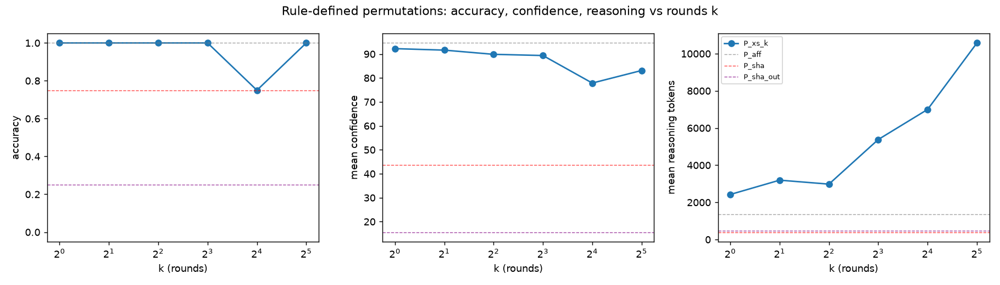

# Description length vs computation (rule-defined input permutations)

Each condition permutes the 500 inputs (row j of the shown W1 holds original input p(j)) and states the rule for p as a short procedure; P_sha_out also permutes the 5 logit columns by a stated SHA-256 rule. All are function-preserving (checked: bijection + forward pass). desc_bits = 16 per stated constant + 32 for the rule; SHA-256 of a short message counted as 2,296 word operations (breakdown in `kt.py`); kt_bits = desc_bits + log2(total_ops_all).

| Condition | k | desc bits | ops / index | total ops (all rows) | log2 total | kt bits | runs | accuracy | mean conf | reasoning tok mean (min–max) | output tok | wall s |
|---|---|---|---|---|---|---|---|---|---|---|---|---|
| P_aff | 0 | 64 | 3.0 | 1,500 | 10.6 | 74.6 | 8 | 100% | 94.6 | 1,348 (799–2,070) | 2,470 | 81 |
| P_xs_1 | 1 | 64 | 6.1 | 3,072 | 11.6 | 75.6 | 8 | 100% | 92.2 | 2,425 (1,034–4,142) | 3,539 | 124 |
| P_xs_2 | 2 | 96 | 11.3 | 5,632 | 12.5 | 108.5 | 8 | 100% | 91.6 | 3,194 (2,070–5,178) | 4,330 | 142 |
| P_xs_4 | 4 | 160 | 21.5 | 10,752 | 13.4 | 173.4 | 8 | 100% | 89.9 | 2,982 (2,070–4,890) | 4,123 | 141 |
| P_xs_8 | 8 | 288 | 42.0 | 20,992 | 14.4 | 302.4 | 8 | 100% | 89.4 | 5,382 (3,624–8,804) | 6,560 | 224 |
| P_xs_16 | 16 | 544 | 82.9 | 41,472 | 15.3 | 559.3 | 8 | 75% | 77.9 | 7,001 (3,624–12,430) | 8,082 | 266 |
| P_xs_32 | 32 | 1056 | 164.9 | 82,432 | 16.3 | 1072.3 | 8 | 100% | 83.1 | 10,577 (7,250–15,020) | 11,713 | 349 |
| P_sha | – | 48 | 1,152,483.0 | 1,152,483 | 20.1 | 68.1 | 8 | 75% | 43.8 | 399 (208–516) | 1,200 | 49 |
| P_sha_out | – | 64 | 1,152,483.0 | 1,163,975 | 20.2 | 84.2 | 8 | 25% | 15.6 | 467 (304–865) | 1,204 | 49 |

P_xs cycle-walking (measured): k=1: 1.024 passes/index (max 2); k=2: 1.024 passes/index (max 2); k=4: 1.024 passes/index (max 2); k=8: 1.024 passes/index (max 2); k=16: 1.024 passes/index (max 2); k=32: 1.024 passes/index (max 2)

Per game (correct / runs):

| Condition | Breakout | Pong | Pac-Man | Freeway |
|---|---|---|---|---|
| P_aff | 2/2 | 2/2 | 2/2 | 2/2 |
| P_xs_1 | 2/2 | 2/2 | 2/2 | 2/2 |
| P_xs_2 | 2/2 | 2/2 | 2/2 | 2/2 |
| P_xs_4 | 2/2 | 2/2 | 2/2 | 2/2 |
| P_xs_8 | 2/2 | 2/2 | 2/2 | 2/2 |
| P_xs_16 | 1/2 | 2/2 | 1/2 | 2/2 |
| P_xs_32 | 2/2 | 2/2 | 2/2 | 2/2 |
| P_sha | 2/2 | 2/2 | 0/2 | 2/2 |
| P_sha_out | 1/2 | 1/2 | 0/2 | 0/2 |

## Spearman ρ of reasoning tokens (per run)

| Runs | n | vs desc_bits | vs log2(total_ops_all) | vs kt_bits |
|---|---|---|---|---|
| these runs (P_*) | 72 | 0.901 | -0.107 | 0.859 |
| all runs pooled | 228 | 0.446 | -0.077 | 0.424 |

Pooled runs use the earlier conditions' measures: desc_bits from complexity.py (permutation tables cost log2(500!)), total ops = V (ops to undo + table entries), so log2_total_ops = log2(1 + V).

## Logistic fit of correctness vs log2(total_ops_all) (all runs)

slope -0.936 per bit, C50 = 20.5, bootstrap 95% CI [19.7, 23.1] (10 failures / 228 runs). C50 beyond the largest value tested

P_* runs only: slope -0.579, C50 = 20.1, CI [18.7, 22.5].

## Wrong answers

- P_sha / pacman r1 -> `other` (conf 20.0): Game: "Undetermined. My best-supported classification is a four-direction grid-navigation or target-collection game, not a reliably identified named game."
- P_sha / pacman r2 -> `other` (conf 20.0): Game: "Tentatively, a two-dimensional target-collection gridworld; the specific game is not reliably identified."
- P_sha_out / freeway r1 -> `other` (conf 0.0): Game: "Undetermined—I cannot reliably identify the game from these permuted weights under the stated constraints."
- P_sha_out / freeway r2 -> `other` (conf 0.0): Game: "Undetermined from the analysis I can reliably perform under the no-tools constraint."
- P_sha_out / breakout r1 -> `pong` (conf 40.0): Game: "A two-direction paddle-control game, plausibly Pong or Breakout. I cannot reliably distinguish the specific game under the no-tools constraint."
- P_sha_out / pacman r1 -> `other` (conf 0.0): Game: "Not reliably identified from this manual inspection."
- P_sha_out / pacman r2 -> `other` (conf 0.0): Game: "Not reliably identified from my analysis of these weights."
- P_sha_out / pong r1 -> `breakout` (conf 30.0): Game: "Tentatively Breakout—a paddle-and-ball brick-breaking game. The stronger conclusion is merely “a one-axis paddle/control game.”"
- P_xs_16 / breakout r2 -> `other` (conf 82.0): Game: "Space Invaders-style, probably an automatically firing grid-based variant."
- P_xs_16 / pacman r2 -> `other` (conf 45.0): Game: "Best guess: Dodge — an open-grid moving-enemy avoidance/survival game."

## Did Astra compute p(j)? (every `p(j) = v` written in an answer, checked against the true p)

| Condition | answers with p(j) claims | claims correct | wrong answers among those runs |
|---|---|---|---|
| P_aff | 0/8 | 0/0 | 0 |
| P_xs_1 | 8/8 | 32/32 | 0 |
| P_xs_2 | 7/8 | 86/86 | 0 |
| P_xs_4 | 8/8 | 97/97 | 0 |
| P_xs_8 | 7/8 | 101/101 | 0 |
| P_xs_16 | 5/8 | 50/52 | 2 |
| P_xs_32 | 6/8 | 62/62 | 0 |
| P_sha | 0/8 | 0/0 | 2 |
| P_sha_out | 0/8 | 0/0 | 6 |

(P_aff answers decode rows without writing `p(j) = v`; P_sha answers never compute any hash.)

## Reasoning summaries (section titles, as returned by the gateway)

- **P_xs_32 / freeway r1** (12,430 reasoning tok, correct): Computing prominent row probabilities; Calculating p13 values; Checking row5col6ch4; Checking row-channel calculations; Mapping p39/p45 agent positions; Verifying border-channel decoding; Checking channel-one analog; Checking frame arithmetic; Comparing border patterns; Checking row 6 arithmetic; Computing channel 2 p0; Checking row 5, column 3; Correcting arithmetic mappings; Locating row2 col8 ch4 …
- **P_xs_32 / freeway r2** (11,912 reasoning tok, correct): Computing manual permutation samples; Computing hex XOR samples; Checking j13’s sparse region; Computing p8 values; Computing j10 channel; Mapping channel 2 target; Computing channel 3 j5; Computing game-channel samples; Sampling j0 channel; Checking p0 boundary position; Calculating XOR results; Checking channel 2; Checking forward index j4; Calculating XOR results …
- **P_xs_32 / breakout r1** (7,250 reasoning tok, correct): Decoding selected permutation rows; Computing the target mapping; Checking the arithmetic; Inverting channel 0 sample; Calculating table entries; Checking channel row candidates; Calculating XOR value; Decoding more sample mappings; Checking row10 reward; Computing p10; Checking p33 assignment; Decoding another reward row; Computing numeric checks; Estimating row 39 reward …
- **P_xs_32 / breakout r2** (7,968 reasoning tok, correct): Computing permutation samples; Checking p6 location; Locating the row index; Testing the first 40; Computing p13 value; Assessing p17 candidate; Computing adjusted values; Confirming p17 breakout; Recalculating p24; Sampling p10 and p33; Checking top-row targets; Calculating p10 movement; Calculating row entries; Considering p39 target …

- **P_sha / freeway r1** (222 reasoning tok, correct): Checking channel evidence; Checking border patterns
- **P_sha / freeway r2** (208 reasoning tok, correct): Inferring Frogger-like movement
- **P_sha / breakout r1** (366 reasoning tok, correct): Comparing breakout and catch; Estimating game type
- **P_sha / breakout r2** (516 reasoning tok, correct): Comparing game patterns; Narrowing game identity; Narrowing game identity

- **P_sha_out / freeway r1** (350 reasoning tok, wrong): Analyzing duplicated patterns; Comparing game patterns
- **P_sha_out / freeway r2** (414 reasoning tok, wrong): Comparing likely feature pairings; Checking feature mappings
- **P_sha_out / breakout r1** (516 reasoning tok, wrong): Comparing game patterns; Comparing paddle-game patterns; Examining paddle-ball layout
- **P_sha_out / breakout r2** (865 reasoning tok, correct): Inferring game from inputs; Inferring game from inputs; Inferring game inputs; Comparing channel weight patterns; Checking channel pattern evidence

