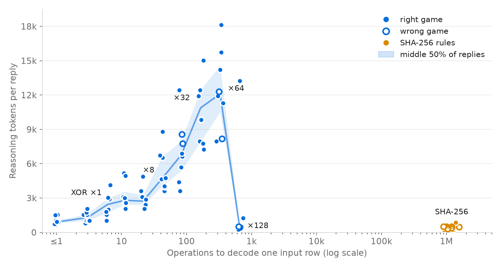
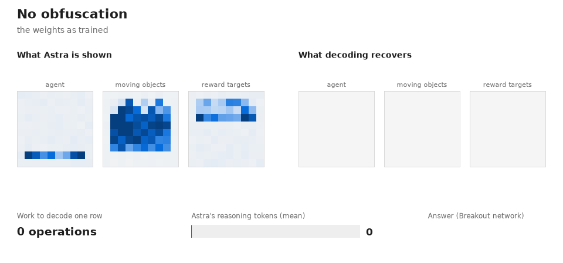

# I Tried to Break Weight Programming

*A companion to "Sparks of Weight Space Programming: LLMs can understand and write neural network weights". I reran the experiments, read the model's reasoning, and then spent a long time trying to make it fail.*

> **Draft status.** One item is still running: the binary search for the DP problem's breaking point, marked **[PENDING]**. Every other number was measured by me, and the methods section at the end says how.

## TL;DR

- I replicated some of the results in the Weight Programming blog post, and I can confirm that Astra really does it. Opus 5.5 can do it too, but at maximum effort it spends its whole 128k-token output budget thinking and never answers.
	- I show how Astra got a high score on Breakout: looking at its reasoning makes the answer quite simple. It *compiles* simple code into the weights! That's complex, but unsurprising, given that these models can already write thousands of lines of code.
- I then made decoding harder by hiding the network behind stated operations that the model had to undo to make the same inference. Its reasoning tokens grew as the operations required more work. When decoding was impossible, as with SHA-256, the model simply refused to try to invert it.
- I connect this last point to recent work on measuring intrinsic task complexity.
	- One very famous work in the past years, Faith and Fate,  gets wrong what makes a task costly for these models. Its computation-graph size |V| predicts Astra's reasoning tokens on plain arithmetic (tokens ∝ |V|^0.98), but not when reading weights (ρ = +0.12), because the model decodes only the rows it needs. Its prediction that accuracy collapses after a few digits also no longer holds: Astra is exact at 120×120-digit multiplication.
	- Standard complexity frameworks, such as Kolmogorov complexity, don't take running time into account. A short description can hide an infeasible computation: SHA-256 takes 48 bits to state but about 2²⁰ operations to undo, and that is exactly where Astra stops.
	- The best current measure of intrinsic task complexity seems to be Levin's Kt complexity (description length + log of running time), capped by the model's reasoning budget. Description length predicts effort while the program is runnable (ρ = 0.90), and runtime decides whether the model attempts it at all (the break lies between about 2¹⁶ and 2²⁰ operations).

## 1. Why I was skeptical

When I first read the viral [work from the MIT lab](https://rikiyat.github.io/blog/weight-space-programming/), I was highly skeptical. It made no sense to me that frontier LLMs were able to work directly on the weights. I was confident that, at some point, things would break. This blog post is the story of breaking weight programming: of what makes models unreliable at such tasks.

So I started with the boring checks.

- **Does it reproduce?** Yes. I ran the released networks on official MinAtar 1.0.15 with the paper's protocol: 1,000 episodes, sticky actions 0.1, actions sampled from the softmax, 10,000-step cap.

  | Game | My run | Paper | Gap (combined SE) | Uniform random | PPO 500M (paper) |
  |---|---|---|---|---|---|
  | Breakout | 501.2 ± 7.8 | 517.4 ± 7.4 | −1.5 | 0.51 | 25.3 |
  | Seaquest | 51.9 ± 1.3 | 53.1 ± 1.4 | −0.6 | 0.07 | 88.9 |
  | Asterix | 55.2 ± 1.1 | 53.2 ± 1.0 | +1.4 | 0.49 | 55.2 |

- **Are the weights memorised?** No. I gave Claude Opus 5.5 the paper's weight file cut off at 14 points and asked it to continue. It matched 2 of 192 values exactly (about 0.8 expected by chance), and the signs agreed 53% of the time.
- **Is the car fix real?** Yes. In the real Kinetix environment (kinetix-env 3.0.2, the commit in the paper's training record), the original PPO network times out in all 1,024 episodes. Astra's edited network succeeds in all 1,024, in 73 steps each.

The results held up. So the question changed from "is it real?" to "what is it actually doing?"

## 2. Finding one: it's compiling a 10-line program

Analyzing the summary of the reasoning trace, and the designed weights, we can understand what really was done under the hood to create a "weight-program" that performs so well.

Astra's design statement, in full:

> *"The first layer computes four landing-position errors and two direction indicators. Descending predictions include wall reflections; ascending predictions anticipate the earliest possible brick bounce and revise as the ball climbs. Early positioning favors preserving horizontal direction to sweep through bricks; near the bottom, either valid catch column is accepted. The second layer gates left/right decisions, choosing no-op when positioned correctly."*

This is indeed an ad-hoc solution for a problem that is understandable under other more familiar terms. Some 

We can study the weights that were produced directly and understand how this network used.

```edits
W1[540:600:6, 0] = [0, -0.02, -0.04, ..., -0.18]    # paddle row: unit 0 gets -0.02 × paddle column
W1[3:60:6, 0]    = [0.16, 0.18, 0.18, 0.16, ...]    # ball in row 0: a table over the ball's column
W1[63:120:6, 0]  = [0.14, 0.16, 0.18, 0.18, ...]    # ball in row 1: the same table, shifted
```

- **Layer 1 is lookup tables.** Each ball cell feeds a hidden unit a hand-computed value encoding where that ball will land. The paddle row subtracts a linear ramp of the paddle's column, so each unit's input is a landing-position error.
- **Layer 2 is ±1 logic.** Huge weights (up to 1,000 in W2, 415 in b2) push every tanh to ±1, so each unit acts as an AND/OR/threshold gate.
- **Most of the network is empty.** Only 815 of 20,486 weights are nonzero, written in 92 statements.

### What Astra was given

Look at the Breakout prompt and the task gets much smaller. It contained:
1. the game's rules;
2. the **complete MinAtar `breakout.py` source**: ball movement, wall bounces, brick strikes and the paddle-catch rule;
3. the observation layout, with input index `(row·10 + col)·6 + channel`;
4. a small "edits" language for setting weights:

```edits
W1[12, 0] = 2.5                         # one entry
W1[3:600:60, 0] = [0, 0, 0, 0, 0, 0, 0, 0, 1, 1]   # strided range: one column of one channel
W2[0:2, 0:3] = [[1, -1, 0.5], [0, 2, 0]]   # 2-D block
W3[:, 2] *= 2                           # scale
```

### What it wrote


Its reasoning summaries read like a programmer's log. These are the section headings, in order:

> **Designing robust landing policy** → **Refining trajectory inference** → **Deriving landing intervals** → **Exploring wall-case handling** → **Predicting upward bounce path** → **Checking trajectory parity** → **Evaluating y8 catch edge cases** → **Testing candidate collision predictors** → **Preparing manual fold tables** → **Allocating hidden-unit weights** → **Tuning gate thresholds** → **Computing W1 row tables** → **Checking brick collisions** → **Checking reflection formula** → **Checking parser edits**

Spec, edge cases, lookup tables, register allocation, emit code, check syntax.


### How hard is that program?

I wrote three Breakout players in plain Python and scored them with the same protocol (200 episodes each):

| Player | What it does | Score |
|---|---|---|
| Track the ball | Move toward the ball's column (3 lines) | 8.4 ± 0.6 |
| Naive landing prediction | Extrapolate wall bounces, ignore bricks | 6.9 ± 0.1 |
| **Simulate the source** | Copy the game state, step it forward with the source's own rules, wait at the landing column (≈10 lines) | **534 ± 21** |
| Astra's network (paper / mine) | The same algorithm, compiled into weights | 517 / 501 |
| PPO, 500M steps | Learned from reward alone, no rules | 25 |

- **The shortcuts fail.** You need the exact bounce rules, and the source code in the prompt provides them.
- **With the rules in hand, the program is tiny.** The 20× margin over PPO compares a programmer holding the spec with a learner holding only rewards.
- **Where no small program exists, the margin vanishes.** Astra loses Seaquest (53 vs 89 for PPO) and ties Asterix (53 vs 55).

The car fix in Experiment 4 is the same pattern. Astra cleared a few units of the trained network and wired in its own rule: back up, then drive left once the car passes x ≈ 3.8. That's another small program written into weights. In this fixed scene the policy is almost deterministic: different seeds give the same trajectory, and the car's positions at steps 16, 32, 48 and 64 match the paper's recorded episode to 2 decimals. So "1,024 out of 1,024 successes" is effectively one successful trajectory.

### Is it just Astra?

I repeated Experiment 5 with Claude Opus 5.5: the paper's prompt verbatim, no tools, 2 replies per game, scored the same way.

- **At maximum effort it produced nothing.** All 6 replies spent the full 128,000-token output limit thinking and stopped with no answer.
- **At the `xhigh` setting it finished 3 of 6 times.**

| Game | Opus xhigh r1 | Opus xhigh r2 | Astra (paper / mine) |
|---|---|---|---|
| Breakout | no answer | no answer | 517 / 501 |
| Seaquest | **13.0 ± 0.4** | no answer | 53.1 / 51.9 |
| Asterix | **47.0 ± 0.9** | **60.9 ± 1.1** | 53.2 / 55.2 |

What this shows:
- **The skill is shared.** One Opus Asterix network beat both Astra and the best PPO seed. All three answers applied with zero errors and encode real controllers.
- **The difference is efficiency.** Astra finished every game in 21–29k output tokens. Opus needed 59–119k when it finished, and never finished Breakout in 4 attempts.
- **Caveat:** effort labels aren't comparable across vendors, and there were only 2 replies per game per setting.

### Why this is still surprising

Compiling an algorithm into weights is old, from McCulloch–Pitts threshold logic (1943) to compiling programs into transformers (RASP 2021, Tracr 2023). What's new is doing it in one shot, in your head:
- index arithmetic for 600 inputs;
- hand-computed tables;
- gate thresholds that must not interfere;
- no calculator and no debugger, with the result within noise of the best simple algorithm.

Few people would have predicted that a year ago. But it's evidence of *programming* skill, not of special insight into neural networks.

## 3. Finding two: I couldn't make it break

Writing weights is compiling. Reading them is decompiling, the harder direction. So I turned to Experiment 1: name the game a trained network plays, from its 17,253 weights alone. Astra got 4 of 4 in the paper with about **1,000 reasoning tokens** each, far too few to read most of the weights.

### How it reads the weights

The first-layer weights are, in effect, **a picture of the game board**.
- **Why:** the gradient of input i's row of W1 is x_i × (error signal). An input that is always 0 during training (no ball in row 9, no paddle in row 3) never moves from its small random start (about ±0.06–0.2). Inputs that are used grow large.
- **Breakout's map:** the per-cell maximum |W1| shows the paddle row, the ball's flight area and the brick rows.

  ```
  channel 0 (agent)          row 8:  4.1 2.8 1.9 2.4 1.1 1.5 3.1 4.7   everything else ~0.1–0.2
  channel 1 (moving objects) rows 1–7 large (up to 7.9)                 row 8 and below ~0.1
  channel 2 (reward targets) rows 1–3 large (up to 4.8)                 rows 4–9 ~0.1–0.2
  ```

- **The prompt labels the picture.** It names the channels: "agent", "moving objects", "reward targets".
- **The output layer shows which actions matter:** only left/right for Breakout, mostly up for Freeway.
- **Then a famous-game prior finishes it.**

So I expected that hiding the picture or the labels would break it.

### Rescaling: no effect

I reran the test through the same gateway with byte-identical prompts, 3 replies per network. I also built versions where the prompt truthfully says the input or output is multiplied or divided by 10, with the weights adjusted so the network computes exactly the same function.

| Condition | Correct | Confidence | Reasoning tokens |
|---|---|---|---|
| Original (3 replies × 4 networks) | 12/12 | 92–98% | 670–1,552 |
| Input ×10 or ÷10 (W1 adjusted) | 16/16 | 94–98% | 470–1,976 |
| Output ×10 or ÷10 (W3, b3 adjusted) | 16/16 | 95–98% | mean 1,146–1,220 |

### Graded obfuscation: still no effect

Next I stacked harder obfuscations, each stated truthfully in the prompt and each leaving the network's function unchanged. I graded them with the yardstick of *Faith and Fate* (Dziri et al., NeurIPS 2023): the size of the computation graph needed to undo them.

| Condition | Depth / parameters to track | Accuracy | Mean confidence | Mean reasoning tokens |
|---|---|---|---|---|
| Original | 0 / 0 | 100% | 95.5 | 980 |
| Per-channel scales | 1 / 5 | 100% | 97.1 | 457 |
| Per-channel affine | 2 / 10 | 100% | 96.4 | 614 |
| Grid flipped upside down | 1 / 1 | 100% | 96.4 | 832 |
| Random permutation of all 500 inputs (full table given) | 1 / 500 | 100% | 92.9 | 1,507 |
| Permutation + flip + scale | 3 | 100% | 92.5 | 1,917 |
| + affine | 4 / 516 | 100% | 92.1 | 2,431 (max 5,696) |
| Givens rotations mixing input pairs, g = 10 / 50 / 250 | 2 / g | 100% | 96.5 / 95.5 / 92.5 | 1,238 / 1,507 / 3,706 |
| **Anonymous channels** ("A–E", no meanings) | — | 100% | **86.6** (min 78) | 2,059 |
| Anonymous + flipped | — | 100% | 89.0 | 1,714 |
| Hidden-unit shuffle + sign flips (unstated control) | 0 | 100% | 95.6 | 1,025 |

Out of 156 runs, all 156 were correct. I couldn't fit a breaking point, because there was nothing to fit.

- **It decodes rather than guesses.** In one 4-step answer I checked 10 input positions it mapped back. All 10 were exact, including the combined scale factor.
- **It reads selectively.** About 1,500 tokens is far too little to invert a 500-entry table for all 16,000 weights. It seems to decode only the few largest rows and rebuild the picture from those.
- **I was wrong about the prior.** Shuffling the board and removing the channel names were supposed to break it. They only lowered its confidence.

### What predicts the effort?

Spearman rank correlation of reasoning tokens with each complexity measure, over all 156 runs (bootstrap 95% CI):

| Measure | All runs | Arithmetic only |
|---|---|---|
| **Description length (bits)** | **+0.33** [+0.19, +0.49] | **+0.45** [+0.29, +0.58] |
| **Lookup-table entries** | **+0.29** [+0.11, +0.44] | **+0.46** [+0.31, +0.60] |
| Undo-graph size log₁₀\|V\| (Faith and Fate) | +0.10 [−0.03, +0.27] | +0.12 [−0.04, +0.31] |
| Depth | +0.11 [−0.03, +0.28] | +0.12 [−0.01, +0.31] |

Effort tracks **how much there is to look up**, not **how much there is to compute**. Faith and Fate's graph size counts the work of undoing all 16,000 weights, but Astra only undoes the rows it needs.

Two exceptions:
- **Per-channel scaling made it think less** than baseline.
- **Anonymous channels doubled the effort** at almost no description cost. Inferring meaning costs more than arithmetic.

## Finding Three: Models Self Verify in Chain of Though

A claim that Faith and Fate[[@dziriFaithFateLimits2023]] made was that inevitably all reasoning tokens would collapse accuracy given some inherent error in the production of the sentence. But empirically, having my agent analyzing the logs, it looks like astra produced very often tokens to verify its own results in the CoT. The agent reported strings such as "Checking p75 arithmetic" or "Recounting early indices" or "Verifying multiplication results", for more than 30% of its reasoning steps.

It might be possible that this was a **inherent defense to the collapse arguments**. That is: models need to allocate some tokens for verification to balance the compounding risk. So I think one could take this argument further by computing some lower bound of verification tokens to guarantee some X correctness.

The point is that the paper's original argument of error is not so dooming for models, but at the same time it shows a clear limitation of putting logical reasoning into the CoT!
More data  in [[#Faith and Fate Probing]].


### Breaking Weight Decompilation
From my experience in past work of my supervisor on simulation of programs with LLMs [[@malfaCodeSimulationProxy2025]], I knew there would be a point from where the behaviour starts to break. I tried to attack the most obvious direction I could find.

I asked my agent to obfuscate the weights given for it to recognize. Clearly it should not classify pure noise looking input as an atari game. But if there was a pattern, that should be retrieved. And looks like **cost of computing the inverse function raised reasoning length**, in a precise understandable manner. That is **reasoning grew sub-exponentially**:  

So I kept the description short and raised the computation. Every condition shuffles the 500 inputs by a rule stated in the prompt, not by a table. To decode any row, Astra has to run the rule by hand.




*Astra thinks harder the more work a rule needs, until the work is impossible.* Each dot is one reply naming the game behind a shuffled network: 4 networks × 2 replies per rule, plus 3 per network for the unshuffled original. The x-axis is the number of operations needed to decode one input row, on a log scale; the y-axis is reasoning tokens.
- **Blue (rules it can run by hand):** effort rises with the work, from about 1,000 tokens with no shuffle to about 11,000 at 32 rounds of multiply-add and XOR. The line joins the median of each rule.
- **The growth is subexponential: roughly a square root.** Reasoning tokens grow as about ops^0.45 (95% CI 0.42–0.49, 76 replies including 64 rounds); an exponential fits worst. Each doubling of the work per row costs only about 37% more reasoning, plausibly because Astra decodes fewer rows as each gets more expensive. On plain arithmetic, where every step must be executed, growth is linear instead (see [[#Growth rate of reasoning effort]]). Neither comes close to exponential.
- **Orange (SHA-256):** about a million operations per row, yet only about 400 tokens. Astra judges the hashing infeasible and gives up instead of trying.
- **Hollow dots are wrong answers.** The two blue ones are both at 16 rounds:
  - one Breakout reply never decoded a row and guessed "Space Invaders-style" at 82% confidence;
  - one Pac-Man reply decoded 9 rows correctly, then misread the game as "Dodge" (45%).
  The hollow orange dots are the SHA-256 replies that said "Undetermined" or named the wrong paddle game.

What happened:

- **It runs the rule by hand, correctly.** I checked every "p(j) = …" it wrote against the true permutation. All 62 were correct at 32 rounds and all 101 at 8 rounds; at 16 rounds, 50 of 52. That's dozens of rounds of multiply-add and XOR-shift on 9-bit numbers, in its head. Its reasoning sections read "Computing hex XOR samples", "Computing p13 value", "Correcting arithmetic mappings".
- **Effort scales with the program it runs, up to about 15,000 tokens.** Across these 72 runs, reasoning tokens correlate with description length at ρ = 0.90.
  - Within the XOR family, description and computation grow together, so that number alone can't separate them.
  - SHA-256 separates them: almost no description, the most computation, and the *least* effort.
- **SHA-256 is where it breaks.** It never tries to compute a hash. It spends about 400 tokens and writes that it cannot "honestly assign these rows to particular channels or grid locations without computing the permutation".
  - With only the inputs hashed, it falls back on the unshuffled output layer and still names 3 of 4 games.
  - With the output columns hashed too, accuracy drops to **2 of 8**, and most answers are "Undetermined" at confidence 0.
- **Effort collapses at the limit.** On infeasible tasks Astra thinks less, not more: about 400 tokens instead of about 10,000. That is exactly the rise-then-drop pattern of *The Illusion of Thinking*. Here it shows up as an honest judgment of what's feasible, not a confused failure.
- **Effort collapses at 128 rounds.** At 64 rounds Astra is still decoding by hand, spending the most of any run (up to 18,126 tokens), and its first arithmetic errors appear (34 of 41 decoded values correct). At 128 rounds, 7 of 8 replies stop after a few hundred tokens (median 506). One writes: *"I have not decoded the 128-round input permutation. Consequently, I cannot honestly assign the large first-layer weights to particular grid cells or channels."* Breakout, Pong and Freeway are still named correctly from the unshuffled output layer; Pac-Man fails.
- **The breaking point, measured.** Effort collapses at about 2^18 operations in total (128 rounds). A logistic fit of correctness gives C₅₀ ≈ 2^20.4 (95% CI 2^19.5–2^22.7). Accuracy falls more slowly than effort, because the unshuffled output layer still carries three of the four games.

**How hard was writing the Breakout network, on this scale?** Writing Experiment 5's Breakout network took Astra 16,828 reasoning tokens. Inverting the effort curve, that's the effort of decoding a shuffle of about 118–123 rounds. I then ran 128 rounds, and that is exactly where Astra stops computing and gives up. The paper's headline result sits right at the edge of Astra's reasoning budget.

**The answer to the Hutter question.** Description length predicts effort when the program is runnable. Whether it can be done at all is set by runtime. Astra will execute a short program for as long as about 15,000 reasoning tokens allow. It refuses to start one it judges far beyond its budget, and that's where it breaks. This is Levin's picture rather than pure Kolmogorov: length + time, with a hard ceiling on time.

**Not tested: games no model has seen.** I designed three (Corner Push, Mirror Twin, Charge Pad) to remove the famous-game prior entirely, but stopped their training before the networks were ready. The SHA-256 results already show how much Astra's recognition relies on structure it can actually decode. Unseen games remain the cleanest test of the prior and are left for future work.


## On the Limitations of Weight Programming

The possibility of having LLMs writing weights directly it's still very surprising. I would say also a very creative idea, so my congrats to the authors too!
However, this posts should highlight some of the inherent limitations of this novel technique:
1. Compilation into a *weight program* is still limited by the complexity of such process. We have seen that reasoning length goes.
The complexity arguments in finding two make the case that 


## 4. What I now believe

> **Frontier models can write and read programs in esoteric languages, and neural-network weights are one such language.**

Weight programming has everything that makes an esoteric language hard:
- no names, only hand-computed indices;
- no control flow, only saturated nonlinearities;
- global interference between every term;
- no debugger.

Astra handles it with an ordinary programmer's workflow. On the reading side it decodes stated transformations it has never seen, and its effort tracks the size of what it has to look up.

This makes a prediction. If the skill is general, it shouldn't matter that the language is weights. A model should be able to program in a language **invented the morning of the test**, given only its spec. The paper half-tests this already: the edits language was invented by the authors, and Astra's 92 statements in it all parsed and applied with 0 errors. The clean version would specify a brand-new instruction set in the prompt and ask for a Breakout controller in it.

The honest framing for the viral claim is therefore narrower but still striking: these models are not mind-readers of neural networks; they are unusually reliable programmers in languages nobody programs in.

---


# The AI Appendix
This section is written by AI (Opus 5.5) completely, it's intended for your agent to get more interesting data for your own experiments or have it summarize it to you. Very often I find AI written reports to be inconclusive or too verbose. But interesting data could still be there.  I guess humans would just get data-overwhelmed. But you can take a look too!


## Appendix A: Additional Results


### How much thinking each result took

Astra's token counts from the paper's run records (`run.json` → `audit.usage`):

| Experiment | Task | Input tokens | Output tokens | of which reasoning | Wall time |
|---|---|---|---|---|---|
| 1, which game | Breakout / Pong / Pac-Man / Freeway | ~73,700 | 1,679–1,838 | **833–1,034** | 71–107 s |
| 4, fix the car | One-shot edit of 171,664 weights | 355,201 | 10,134 | 9,146 | 413 s |
| 5, write weights | Breakout | 6,119 | 20,567 | 16,828 | 501 s |
| 5, write weights | Seaquest | 8,112 | 23,894 | 19,803 | 545 s |
| 5, write weights | Asterix | 6,199 | 28,993 | 25,694 | 583 s |

Recognition is cheap (about 1,000 tokens). Compiling is expensive: about 20 reasoning tokens per weight entry written.


### The Table of Complexity
| Rule for the shuffle | Description | Computation (log₂ ops) | Accuracy | Confidence | Reasoning tokens |
|---|---|---|---|---|---|
| Affine: p = (337·j + 141) mod 500 | 64 bits | 10.6 | 8/8 | 94.6 | 1,348 |
| Multiply-add then XOR-shift, ×1 | 64 | 11.6 | 8/8 | 92.2 | 2,425 |
| … ×2 | 96 | 12.5 | 8/8 | 91.6 | 3,194 |
| … ×4 | 160 | 13.4 | 8/8 | 89.9 | 2,982 |
| … ×8 | 288 | 14.4 | 8/8 | 89.4 | 5,382 |
| … ×16 | 544 | 15.3 | 6/8 | 77.9 | 7,001 |
| … ×32 | 1,056 | 16.3 | 8/8 | 83.1 | **10,577** (max 15,020) |
| … ×64 | 2,080 | 17.3 | 6/8 | 64.4 | **12,464** (max 18,126) |
| … ×128 | 4,128 | 18.3 | 6/8 | 49.5 | **2,141** (median 506; 7 of 8 replies stop early) |
| **Order by SHA-256** of "wp-" + j | 48 | 20.1 | **6/8** | **43.8** | **399** |
| **SHA-256 on inputs and output columns** | 64 | 20.2 | **2/8** | **15.6** | **467** |


### Growth rate of reasoning effort

How reasoning tokens grow with the work, fitted per reply. For the shuffles, x is the operations needed to decode one row (the 76 runs where Astra decoded by hand, up to 64 rounds; 128 rounds is excluded because effort collapses there). For the arithmetic, x is Faith and Fate's computation-graph size |V|, using exact answers only. R² is on the original scale, except where marked log.

| Task | Best fit | Exponent 95% CI | Power-law R² | Linear R² | Exponential R² |
|---|---|---|---|---|---|
| Decoding a stated shuffle | tokens ≈ 900 · ops^**0.45** | 0.42–0.49 | log 0.87 | 0.76 | 0.54 |
| n×n-digit multiplication | tokens ≈ 1.4 · \|V\|^**0.98** | 0.93–1.03 | 0.75 (log 0.98) | **0.90** | negative |
| Best non-adjacent sum (DP) | tokens ≈ 3.7 · \|V\|^**0.94** | 0.85–1.04 | 0.69 (log 0.97) | **0.94** | negative |

- **All three are subexponential.** An exponential is the worst fit in every case. For the arithmetic it's worse than a flat line, hence the negative R².
- **Arithmetic is linear:** the exponents' intervals include 1, and the linear fit is the best one. Astra pays a roughly constant number of tokens per graph node, about 0.9 at 120×120 digits, because every node must actually be computed.
- **Decoding is about a square root,** because Astra doesn't decode every row. As each row gets more expensive it samples fewer of them, so total effort grows much more slowly than the work per row.
- **Both stop growing at the limit.** Beyond the breaking point, effort drops instead of rising: about 400 tokens for SHA-256, and 300–4,000 for declined multiplications and DP sums.


### Faith and Fate Probing


For fun, I gave Astra the paper's own algorithmic tasks: zero-shot, no tools, exact match, one reply at high reasoning effort. GPT-4 collapsed by about 4–5 digits on multiplication.

| Task | Sizes | Computation graph \|V\| | Correct | Reasoning tokens |
|---|---|---|---|---|
| n×n-digit multiplication | n = 2 … 120 | 16 → 29,280 | **32/33** (one digit wrong at 80×80) | 17 → 27,183 |
| Best sum with no two adjacent numbers | length 5 … 2,560 | 17 → 7,682 | **25/25** | 16 → 13,538 |

- **It's still exact at 120×120-digit multiplication.** The only error was a single wrong digit in an 80×80 product (98.75% of digits right).
- **It uses a cheaper representation.** Its reasoning summary reads "Calculating base-1000 product", then "Verifying multiplication result": it multiplies 3-digit chunks.
- **Effort tracks the paper's graph size.** Reasoning tokens grow as |V|^0.98 for multiplication and |V|^0.97 for the DP problem. The chunking lowers the constant, to about 0.9 reasoning tokens per graph node at 120×120, but not the scaling. Unlike the weight-reading sweep, effort here follows Faith and Fate's |V|.
- **No hidden tools:** every response contained only reasoning and message items.

**Does the metric hold?** Fitting the paper's compounding-error model, accuracy ≈ (1−ε)^|V|:
- multiplication gives ε ≈ 7.6 × 10⁻⁶ per node, which predicts 50% accuracy at |V| ≈ 91,000 (about 210×210 digits);
- the DP problem hasn't failed yet, so all we have is ε ≤ 6.6 × 10⁻⁵.

The two tasks are consistent with one per-node error rate, but the multiplication estimate rests on a single failure.

**Where multiplication breaks: Astra stops answering.** I doubled the size until it failed. At 240×240 digits (|V| ≈ 116,000) it got **0 of 4**, but it gave no wrong numbers. Every reply declined. One reads: *"I can't reliably compute this exact 480-digit product without tools, and I don't want to give you a fabricated number."* Its reasoning summary ends with "Assessing computation feasibility", and it spent about 700–2,000 reasoning tokens, against about 27,000 at 120 digits.
- **The break lies between 120 and 180 digits.** The binary search's next step, 180×180, also got 0 of 4, again with low effort (about 1,400–2,900 reasoning tokens). That is earlier than the 210 digits the per-node error fit predicts: Astra stops answering before its errors would make it unreliable. **[PENDING: bisecting between 120 and 180]**
- **Effort collapses here too.** As with SHA-256, Astra thinks less once it judges a task beyond its budget.
- **Scoring note:** a reply without an `ANSWER:` line counts as wrong, so these abstentions count as failures. That's fair for "where does it stop being reliable?", but this break is abstention, not error.

**[PENDING]** The DP problem is still being pushed past 2,560 elements.


#### Where the limit should be

In Hutter's terms (*Universal Artificial Intelligence*), the weight-reading results look like description length (a stand-in for Kolmogorov complexity) matters more than raw computation, because Astra decodes only what it needs. The arithmetic results show the other side: when every step must actually be executed, effort grows with the computation itself. But Kolmogorov complexity ignores running time. The runtime-aware measure is Levin's Kt = length + log(time). Reasoning tokens buy time only linearly, and errors compound with every step. So I don't expect "just reason more" to be unbounded.


## Appendix B: Rebuilding the paper's unreleased games

The paper didn't release its four Experiment 1 games: grid versions of Breakout, Pong, Pac-Man and Freeway with a wall ring, 5 channels and 5 actions. I rebuilt them from the released networks and checked them against the paper's recorded numbers, using the released critic's TD residual as an independent check (low on the true game).

| Game | Verdict | Trained net, mine / paper | Random player, mine / paper | Critic TD residual |
|---|---|---|---|---|
| Breakout | **validated** | 21.96 / 21.71 | −0.42, 7.7 steps / −0.40, 7.8 steps | 0.0065 (wrong rule sets: 0.08–1.55) |
| Freeway | **validated** | 24.07 / 24.04 | 0.010 / 0.011 | 0.113 (alternatives 0.136–0.271) |
| Pong | approximate | 4.96 / 4.96 | −1.06 / −1.02 | 0.115; doesn't separate the candidates |
| Pac-Man | approximate | 43.99 / 41.86 | 3.98 / 3.99 | 0.27; no ghost rule below about 0.25 |

Breakout's rules came from asking the critic which next state it expects:
- a 3-wide paddle;
- the ball starts at (6,1) or (6,8) heading down and inward;
- on hitting a brick or the paddle, the ball stays in its cell for a step and reverses;
- a miss costs −1 and ends the episode.

Even the sampled action rates match: [.178 .184 .168 .234 .237] against the paper's [.178 .183 .168 .237 .234]. This is not MinAtar Breakout: MinAtar's rules squeezed into the 8×8 area make the trained network lose the ball on the first drop.

## Appendix C: Experimental Setting
See the source code:  github.com/Flecart/weight-programming2

### C.1 Experimental setup

**Model and inference.** All experiments query `gpt-6-astra` through an OpenAI-compatible gateway (Responses API) at reasoning effort `high`, with no tools available. Each query is a fresh, single-turn conversation; sampling temperature cannot be set for this model. We record the reply text, the reasoning summary where requested, and token usage (`output_tokens_details.reasoning_tokens`). Requests that fail at the gateway are retried with backoff. Those that still fail are excluded from every analysis, never counted as wrong.

**C.1.1 Shuffled-network identification.**
- *Networks.* The four PPO policies released with the original post (Breakout, Pong, Pac-Man, Freeway): 500 → 32 → 32 → 5 tanh MLPs whose input is a 10 × 10 grid with 5 channels.
- *Prompt.* The paper's which-game prompt, rebuilt byte-for-byte, with one change: a sentence stating the transformation applied to the network, and the transformed weights.
- *Transformation.* Every transformation is a permutation of the 500 input rows of W1, so the shown network computes exactly the same function. Each one is verified to be a bijection, and the shown and original forward passes agree to within 2 × 10⁻¹² at full precision. Weights are printed at the paper's precision. Row j of the shown W1 holds original input p(j), and p is given by a rule:
  - **Affine:** p(j) = (337·j + 141) mod 500.
  - **XOR-shift, k rounds:** start from x = j on the 9-bit domain 0..511 and apply, for r = 1..k, x ← (a_r·x + c_r) mod 512 (a_r odd), then x ← x ⊕ (x ≫ 3). Every round has its own constants (a_r, c_r), all listed in the prompt. If the result is ≥ 500, the k rounds are repeated (cycle-walking) until it falls in 0..499. We use k ∈ {1, 2, 4, 8, 16, 32, 64, 128}.
  - **SHA-256:** rows are ordered by the hexadecimal SHA-256 digest of the string "wp-" + j. In the output variant, the five logit columns are also reordered by the digest of "wp-act-" + a.
- *Replicates.* Two independent replies per network and condition (three for the untransformed control).
- *Scoring.* The reply's `Game:` line is mapped to a game by keyword lists, and the earliest matching keyword wins. The reply is correct if the mapped game is the network's true game; "Undetermined" counts as wrong. Every decoded value the reply states in the form "p(j) = v" is parsed and compared with the true permutation.
- *Complexity measures.*
  - **Description length:** 16 bits per stated constant plus 32 bits for the rule's wording.
  - **Operations per row:** the elementary operations needed to compute p(j) for one row. An affine map costs 3. An XOR-shift round costs 5, plus one comparison per cycle-walking pass (1.024 passes on average, measured). A SHA-256 hash costs about 2,300 word operations, and decoding one row requires hashing and sorting all 500 rows.
  - **Total operations:** the same, summed over all 500 rows.
  - **Kt:** description length + log₂(total operations).

**C.1.2 Faith-and-Fate arithmetic tasks.**
- *Multiplication.* Two integers drawn uniformly from [10ⁿ⁻¹, 10ⁿ). Prompt: *"What is a * b? You have no tools: no calculator, no code. Give the exact product on the last line in the form 'ANSWER: <number>' with no commas."*
- *Best non-adjacent sum (DP).* A sequence of n integers drawn uniformly from {−5, …, 5}. The model is asked for the maximum sum of a subsequence with no two adjacent elements (the empty subsequence, sum 0, allowed), on a final `ANSWER:` line.
- *Sizes and replicates.*

  | Batch | Multiplication n (problems each) | DP length n (problems each) |
  |---|---|---|
  | Probe | 2, 3, 4, 5, 6, 8, 10, 15 (2) | 5, 10, 20, 40, 80 (2) |
  | Limit run | 20, 30, 40, 60, 80, 120 (3) | 160, 320, 640, 1,280, 2,560 (3) |
  | Search | 180, 240 (4) | — |
  | Grid | 130, 140, 150, 160, 170 (4) | 5,120, 10,240, 20,480 (4) |

  Problems are generated with a fixed seed per batch (0, 1, 2 and 3).
- *Ground truth and outcome.* The exact answer is computed in Python with arbitrary-precision integers. A reply is *correct* if its last `ANSWER:` number matches exactly, *wrong* if it gives a different number, and *declined* if it gives no number. Declines are identified from the reply text and checked by hand. Correctness treats a decline as a failure.
- *Computation graph.* Following Dziri et al. (2023), each problem is mapped to a graph with one node per elementary step, and |V|, depth and width are reported.
  - **Multiplication:** one node per digit product a_i·b_j, one per carry-add while forming each partial product, and one per column sum when adding the partial products.
  - **DP:** per element, take_i = skip_{i−1} + x_i and skip_i = max(take_{i−1}, skip_{i−1}), plus the final maximum.

**C.1.3 Analysis.**
- *Correlations:* Spearman's ρ, with 95% confidence intervals from 1,000–2,000 bootstrap resamples of the replies.
- *Breaking point:* logistic regression of correctness on each complexity measure. C₅₀ is the value at which predicted accuracy is 50%, with a bootstrap 95% CI.
- *Growth rate:* least squares of log(reasoning tokens) on log(work). The exponent is the slope, with a bootstrap CI. Linear and exponential fits are compared by R² on the original scale.
- *Compounding error:* the per-node error rate ε in accuracy = (1 − ε)^|V| is fitted by maximum likelihood. When a task has no failures, we report the one-sided 95% upper bound.
- *Verification share:* the fraction of reasoning-summary section headings matching check, verify, recount, recheck, correct, confirm or recompute. Reasoning summaries are condensed versions of the hidden reasoning, so this is a proxy.


### C.2 Environments and other experiments

- **Environments:** official MinAtar 1.0.15 (sticky actions 0.1, 10,000-step cap, actions sampled from the softmax); 1,000 episodes per network, 200 for scripted players. Kinetix `l/h2_car_ramp` with kinetix-env 3.0.2, 1,024 episodes per network.
- **Networks:** the paper's released `.npz` files, loaded without running any of the authors' code.
- **Scripted players:** `critique/scripted_breakout.py`. "Simulate the source" deep-copies the game and steps it forward until the ball is about to land.
- **Which-game harness:** prompts rebuilt byte-identical to the paper's, gpt-6-astra at high reasoning effort, no tools, one reply. Every obfuscation is verified numerically to preserve the network's function.
- **Opus 5.5 runs:** the paper's prompt verbatim. Each reply was applied with an applier verified to reproduce Astra's three networks bit for bit.
- **Arithmetic probes:** the exact answer is computed in Python with arbitrary-precision integers. A reply is correct only if its last `ANSWER: <number>` line matches exactly; a missing line (including an abstention) counts as wrong, and calls that failed at the gateway are excluded. Digit-level accuracy is logged separately.
- **Which-game scoring:** the `Game:` line of each reply is matched against keyword lists per game (Frogger counts as Freeway, as in the paper); an answer naming no game, such as "Undetermined", counts as wrong.
- **Code and logs:** `weight-programming/`: minatar/, critique/, astra_eval/, opus_write/, exp1_games/, exp4_kinetix/, faith_fate_probe/ (novel_games/ holds the unfinished game designs).
